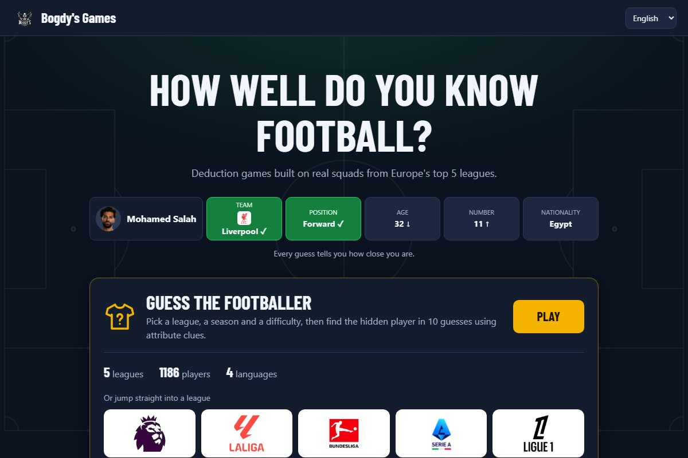
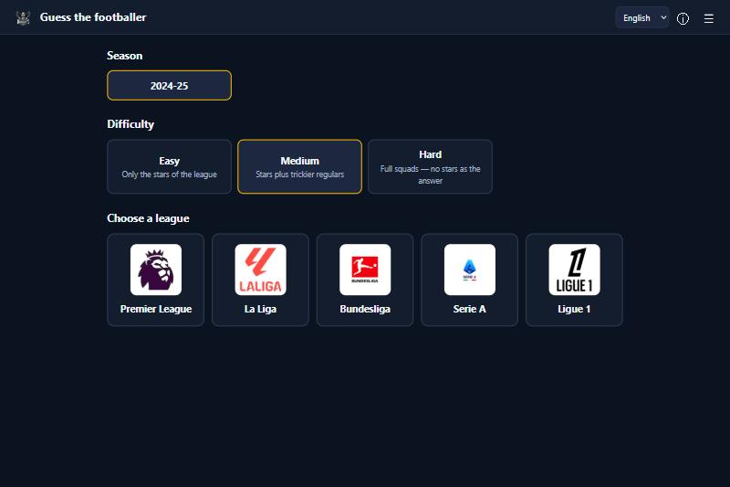
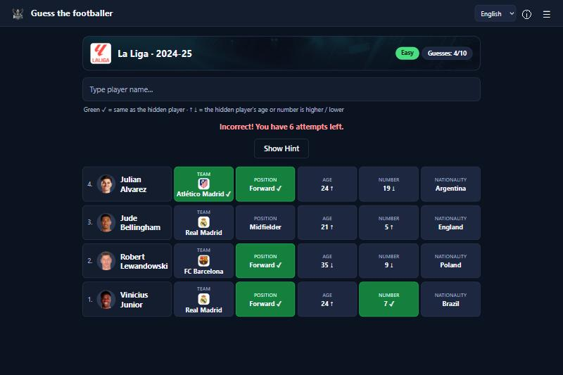

# ⚽ Bogdy's Games — Guess the Footballer

[](https://bogdandumitrascu04.github.io/Guessthefootballer/)

**🎮 Play now: [bogdandumitrascu04.github.io/Guessthefootballer](https://bogdandumitrascu04.github.io/Guessthefootballer/)** — no install needed.

A small platform of browser games built entirely with **vanilla JavaScript, HTML and CSS** — no frameworks, no build step. The first game is **Guess the Footballer**, a Wordle-style deduction game: pick a league, a season and a difficulty, then find the hidden player in at most 10 guesses.



## Guess the Footballer

1. Choose a **league**, a **season** and a **difficulty**.
2. Type a player's name — an autocomplete list with photos and club badges helps you search.
3. Each guess adds a row to the grid, so every attempt stays visible:
   - 🟩 **Green ✓** — the attribute (team, position, age, shirt number, nationality) matches the hidden player.
   - **↑ / ↓ arrows** — whether the hidden player's age or shirt number is higher or lower than your guess.
4. Stuck? **Hints unlock as you play**: the club after 3 guesses, the age after 6.
5. Guess the player within 10 attempts to win.




### Difficulty modes

Every player in the database has a curated **tier**: 1 = league star, 2 = regular starter, 3 = deep squad.

| Mode | The hidden player is… |
|------|------------------------|
| 🟢 Easy | one of the **stars** of the league (tier 1) |
| 🟡 Medium | a star or a trickier regular (tiers 1–2) |
| 🔴 Hard | **never a star** — regulars and deep-squad players only (tiers 2–3) |

### Leagues and seasons

| League | 2026/27 (full squads) | 2024/25 (hand-curated) |
|--------|-----------------------|------------------------|
| Premier League | 546 | 275 |
| La Liga | 522 | 191 |
| Bundesliga | 521 | 203 |
| Serie A | 593 | 292 |
| Ligue 1 | 482 | 225 |

**2026/27** is built by a Python script from three sources: full squads from football-data.org, photos and shirt
numbers from API-Football (88–95% of players, linked by club, name and age), and difficulty tiers suggested by
Transfermarkt market values. **2024/25** is the original hand-curated season.

## Features

- **Wordle-style attribute grid**: every guess stays on screen, newest first
- **Three difficulty modes** driven by per-player tiers
- **Season selection** — the current season (2026/27) or 2024/25; a new season is one script run, zero code changes
- **Autocomplete search** with player photos and club badges, keyboard navigation (Enter picks the highlighted name), and no need for accents ("odegaard" finds "Ødegaard")
- **Responsive layout** for phones and desktops
- **Hints that unlock** after 3 and 6 guesses (club, then age), so the game stays about deduction
- **Share your result** as a spoiler-free emoji grid (🟩⬜…): the share sheet on phones, the clipboard on desktop
- **4 languages** — English, Spanish, French and Romanian, switchable live; choice persists between visits
- **Fully static** — one game engine + JSON data, runs on any static file server

## Architecture

One parameterized engine replaces the old copy-per-league code. League and season data live in versioned JSON files — adding the 2025/26 season means dropping new files into `data/seasons/2025-26/` and listing them in the manifest.

```
├── index.html                     # Platform hub — pick a game
├── games/
│   └── guess-the-footballer/
│       ├── index.html             # League / season / difficulty picker
│       ├── game.html              # game.html?league=…&season=…&difficulty=…
│       ├── engine.js              # All game logic, one copy
│       ├── i18n.js                # EN / ES / FR / RO dictionaries
│       └── game.css               # Theming via a --league-bg CSS variable
├── scripts/                       # Python: download the sources, build a season's JSON
├── tests/                         # pytest
├── data/
│   ├── manifest.json              # Available leagues and seasons
│   └── seasons/2024-25/           # One JSON per league (players + tiers)
├── fonts/                         # Self-hosted headline font
├── images/                        # Club badges and player photos
└── screenshots/
```

## Run it locally

You can [play it online](https://bogdandumitrascu04.github.io/Guessthefootballer/) without installing anything. To run it locally, serve the folder over HTTP (player data is loaded with `fetch()`, so opening files directly from disk won't work):

```bash
git clone https://github.com/BogdanDumitrascu04/Guessthefootballer.git
cd Guessthefootballer

python scripts/serve.py
```

Then open <http://localhost:8765> in your browser. Unlike `python -m http.server`, this server makes the browser check every file for changes, so a test never shows an old copy from the cache.

## Roadmap

- **In progress: PostgreSQL database (Supabase)** with full squads for three seasons (2024/25 to 2026/27), replacing the hand-written JSON
- **Higher or Lower**: which player has the higher market value?
- **Career Path**: guess the player from their clubs and years
- **User accounts** with statistics and streaks
- **Icons mode** — guess legendary players, possibly from their silhouette
- **Daily challenge** — the same hidden player for everyone, with streaks
- Per-league statistics and more games on the platform

## Credits

Data: [football-data.org](https://www.football-data.org/) (squads), [API-Football](https://www.api-football.com/)
(photos, shirt numbers, club badges for 2026/27), [transfermarkt-datasets](https://github.com/dcaribou/transfermarkt-datasets)
(market values, CC0). Non-commercial project.

Headline font: [Barlow Condensed](https://github.com/jpt/barlow), SIL Open Font License (`fonts/OFL-LICENSE.txt`).

## How it was built

I designed the game, set the rules and tested every change. Most of the code was generated with an AI assistant (Claude).

## Author

**Bogdan Dumitrascu** — [GitHub](https://github.com/BogdanDumitrascu04)
