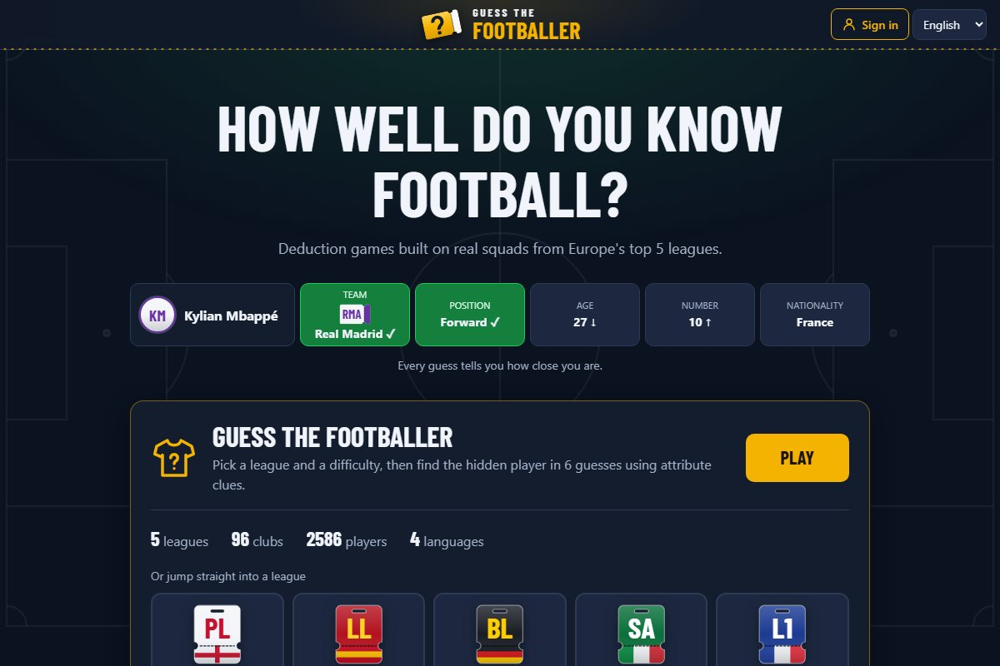
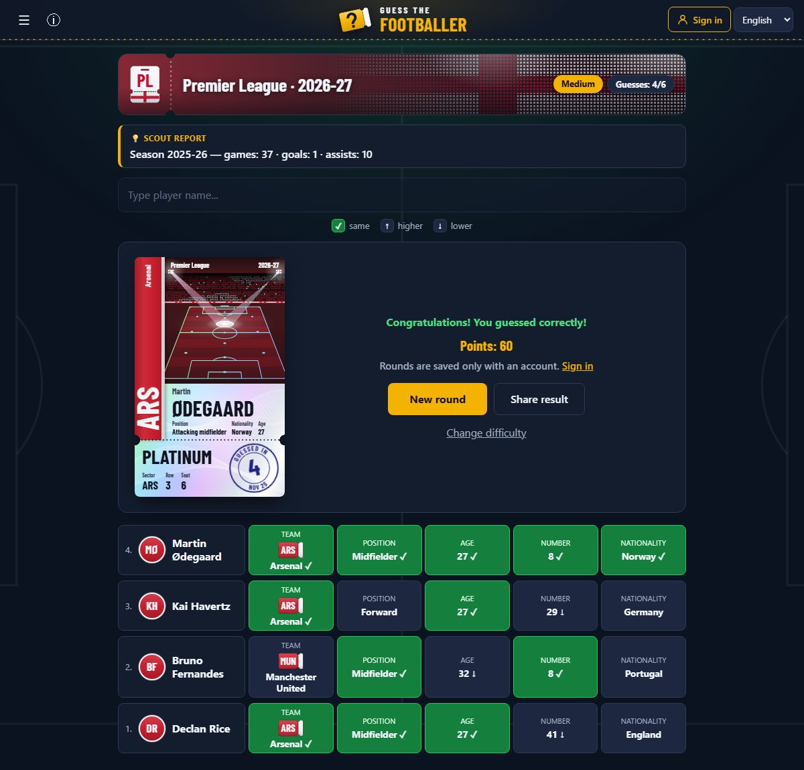
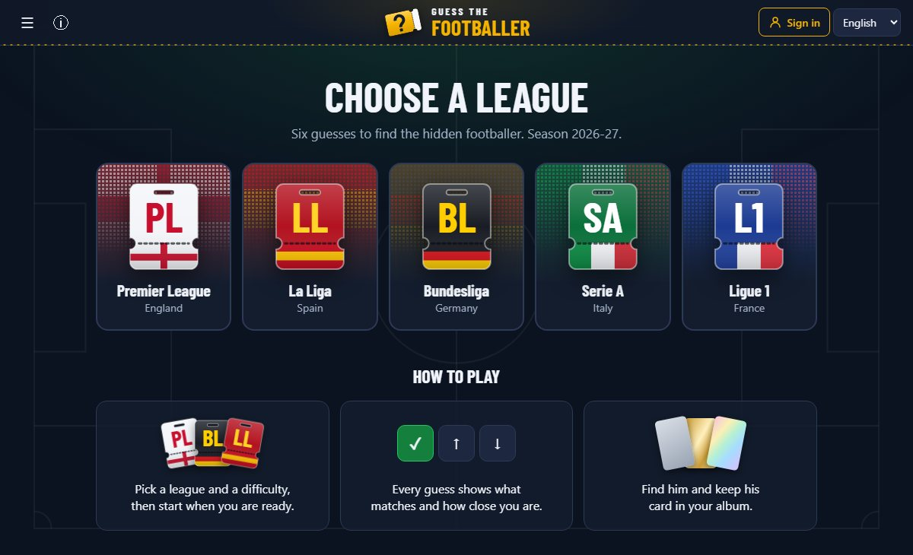
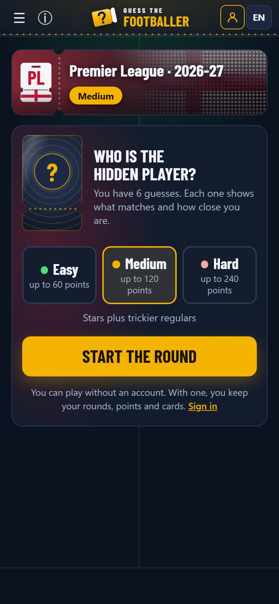
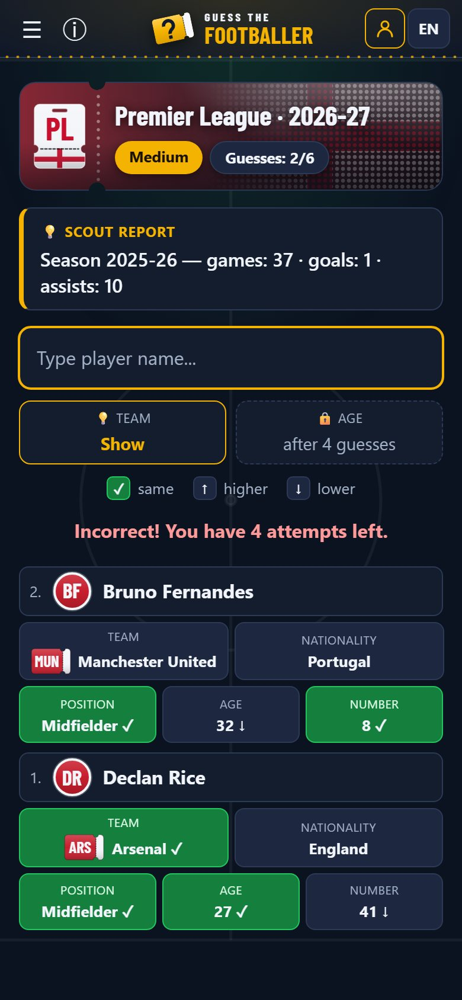
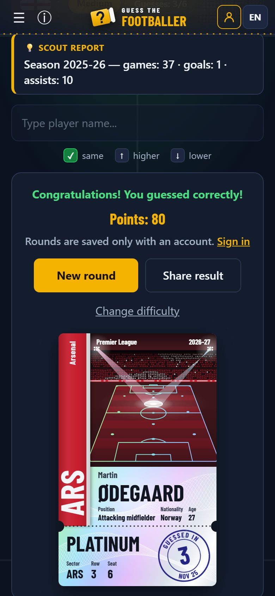

# ⚽ Guess the Footballer

[](https://bogdandumitrascu04.github.io/Guessthefootballer/)

**🎮 Play now: [bogdandumitrascu04.github.io/Guessthefootballer](https://bogdandumitrascu04.github.io/Guessthefootballer/)** — no install needed.

A small platform of browser games built entirely with **vanilla JavaScript, HTML and CSS** — no frameworks, no build step. The first game is **Guess the Footballer**, a Wordle-style deduction game: pick a league and a difficulty, then find the hidden player in at most 6 guesses.



## Guess the Footballer

1. Choose a **league** and a **difficulty**, then press **Start the round**: until then nothing counts.
2. Type a player's name — an autocomplete list, with each player's club, helps you search.
3. Each guess adds a row to the grid, so every attempt stays visible:
   - 🟩 **Green ✓** — the attribute (team, position, age, shirt number, nationality) matches the hidden player.
   - **↑ / ↓ arrows** — whether the hidden player's age or shirt number is higher or lower than your guess.
4. Stuck? **Hints unlock as you play**: the club after 2 guesses, the age after 4.
5. Guess the player within 6 attempts to win. The answer is shown as his match ticket; signed in, you keep it in your album.




  

### Difficulty modes

Every player has a **tier**, suggested by his market value within the league: 1 = star, 2 = regular starter, 3 = deep squad.

| Mode | The hidden player is… |
|------|------------------------|
| 🟢 Easy | one of the **stars** of the league (tier 1) |
| 🟡 Medium | a star or a trickier regular (tiers 1–2) |
| 🔴 Hard | **never a star** — regulars and deep-squad players only (tiers 2–3) |

### Leagues

| League | Players (2026/27) |
|--------|-------------------|
| Premier League | 544 |
| La Liga | 505 |
| Bundesliga | 508 |
| Serie A | 570 |
| Ligue 1 | 459 |

The squads are built by a Python script from three sources: full squads from football-data.org, shirt numbers from
API-Football (linked by club, name and age), and card tiers suggested by Transfermarkt market values.
Who can be hidden on Easy, Medium and Hard comes from a fame score (Wikipedia views and languages, highest market
value, caps, Champions League games), cut separately in each league and checked by hand (`data/fame.csv`).

## Features

- **Wordle-style attribute grid**: every guess stays on screen, newest first
- **Three difficulty modes** driven by per-player tiers
- **No photos and no logos**: a club is drawn as a ticket stub from its code and colours, a league as a season pass, a player as a match ticket with a floodlight on his position
- **Album**: every player you guess while signed in becomes a card, with a stamp for the number of guesses
- **Installable (PWA)**: opens full screen from the phone's home screen; online it always takes the newest files, offline it keeps the leagues you have played
- **New seasons without code changes**: one script run; the season picker appears when there is more than one
- **Autocomplete search** with keyboard navigation (Enter picks the highlighted name) and no need for accents ("odegaard" finds "Ødegaard")
- **Responsive layout** for phones and desktops
- **An opening clue** for every round, built from data: a scout report on Easy and Medium (last transfer, last season's numbers), a "Did you know?" on Hard (exact position, caps, peak value, foot and height...)
- **Hints that unlock** after 2 and 4 guesses (club, then age), so the game stays about deduction
- **Points** for every win: 60 / 120 / 240 at the first guess on Easy / Medium / Hard, one step less for each extra guess or hint
- **Share your result** as a spoiler-free emoji grid with a link to a result page (summary, every guess on request, the answer behind a spoiler button) (🟩⬜…): the share sheet on phones, the clipboard on desktop
- **4 languages** — English, Spanish, French and Romanian, switchable live; choice persists between visits
- **Player of the day**: the same hidden player for everyone, one round a day, with a streak of its own and a share text without spoilers. The calendar lives in PostgreSQL: row-level security hides the days that have not begun, and a unique index allows one round per player and day
- **Accounts (optional)**: Google sign-in through Supabase Auth; rounds, statistics and streaks in PostgreSQL, protected by row-level security
- **No build step** — one game engine + JSON data, runs on any static file server

## Architecture

One parameterized engine replaces the old copy-per-league code. League and season data live in versioned JSON files — adding a season means building its files into `data/seasons/` and listing it in `data/manifest.json`.

```
├── index.html                     # Platform hub — pick a game
├── sw.js, pwa.js, manifest.webmanifest # The installable app: network first, a copy for offline
├── games/
│   └── guess-the-footballer/
│       ├── index.html             # League and difficulty picker
│       ├── game.html              # game.html?league=…&difficulty=…
│       ├── engine.js              # All game logic, one copy
│       ├── round.js               # A finished round as a short code for links
│       ├── common.js              # Guess rows and tiles, shared by the game and the result page
│       ├── kickoff.js             # The screen before a round
│       ├── badge.js, league-marks.js # The clubs' and the leagues' own badges, drawn in SVG
│       ├── album/                 # The match tickets and the album (ES modules)
│       ├── result.html / result.js # result.html?r=…: a shared round
│       ├── daily.js, daily.css    # The player of the day (game.html?daily)
│       ├── auth.js, saved-rounds.js, profile.* # Accounts
│       ├── i18n.js                # EN / ES / FR / RO dictionaries
│       └── game.css
├── sql/                           # PostgreSQL schema, row-level security, statistics
├── scripts/                       # Python: download the sources, build a season's JSON
├── tests/                         # pytest (data scripts, SQL), node --test (rounds, site files)
├── data/
│   ├── manifest.json              # Available leagues and seasons
│   └── seasons/2026-27/           # One JSON per league (players + tiers)
├── fonts/                         # Self-hosted headline font
├── images/                        # App icons, share image
└── screenshots/
```

## Run it locally

You can [play it online](https://bogdandumitrascu04.github.io/Guessthefootballer/) without installing anything. To run it locally, serve the folder over HTTP (player data is loaded with `fetch()`, so opening files directly from disk won't work):

```bash
git clone https://github.com/BogdanDumitrascu04/Guessthefootballer.git
cd Guessthefootballer

python scripts/serve.py
```

Then open <http://localhost:8765> in your browser. Unlike `python -m http.server`, this server makes the browser check every file for changes, so a test never shows an old copy from the cache.

## Roadmap

- **In progress: PostgreSQL database (Supabase)** with full squads for three seasons (2024/25 to 2026/27), replacing the JSON files
- **Higher or Lower**: which player has the higher market value?
- **Career Path**: guess the player from their clubs and years
- **Icons mode** — guess legendary players, possibly from their silhouette
- **Rounds checked on the server**, then a leaderboard
- Per-league statistics and more games on the platform

## Credits

Data: [football-data.org](https://www.football-data.org/) (squads), [API-Football](https://www.api-football.com/)
(shirt numbers), [transfermarkt-datasets](https://github.com/dcaribou/transfermarkt-datasets)
(market values, CC0), [Wikidata](https://www.wikidata.org/) (Wikipedia languages, CC0) and
[Wikimedia pageviews](https://wikitech.wikimedia.org/wiki/Analytics/AQS/Pageviews) (article views, CC0). Non-commercial project.

Headline font: [Barlow Condensed](https://github.com/jpt/barlow), SIL Open Font License (`fonts/OFL-LICENSE.txt`).

## How it was built

I designed the game, set the rules and tested every change. Most of the code was generated with an AI assistant (Claude).

## Author

**Bogdan Dumitrascu** — [GitHub](https://github.com/BogdanDumitrascu04)
